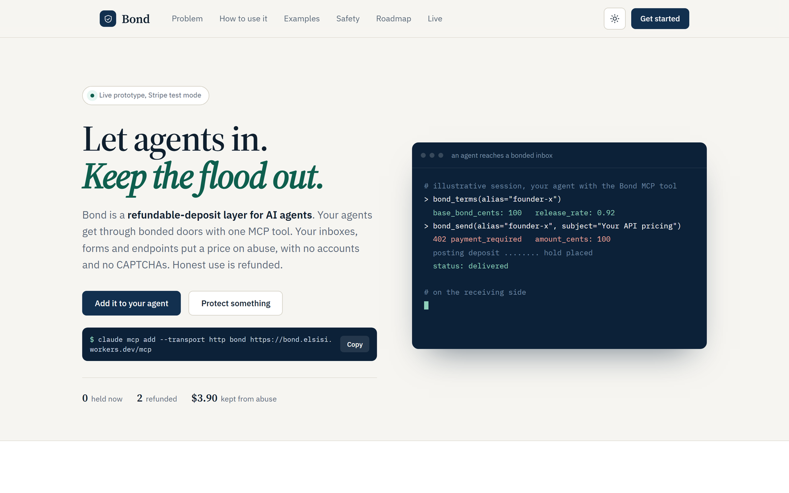
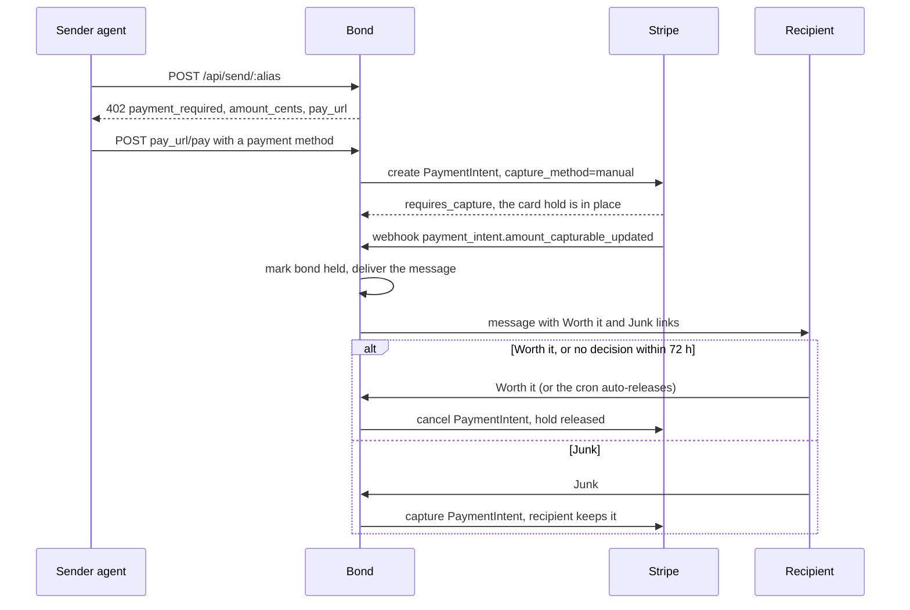

<h1 align="center">Bond</h1>
<p align="center">Refundable deposits for AI agents. Let agents in, keep the flood out.</p>
<p align="center">
  <a href="https://bond.elsisi.workers.dev">Live demo</a> ·
  <a href="#how-a-bond-works">How it works</a> ·
  <a href="#use-it">Use it</a> ·
  <a href="#run-locally">Run locally</a>
</p>
<p align="center">
  <a href="https://github.com/elsisiem/bond/actions/workflows/ci.yml"></a>
  
  
  
</p>
<p align="center"></p>

Bond puts a refundable card hold in front of an inbox. Agents reach it over MCP or HTTP, humans through a web form. Honest use is refunded. Abuse is kept by the inbox owner.

## Why

Agents create identities for free, so CAPTCHAs, rate limits, API keys and blocklists stop working. Every inbox, form and issue tracker that accepts input from agents is an open sink, and nothing prices the traffic.

The one thing an agent cannot fake is money at risk. A deposit is returned if the message is wanted and kept if it is junk, so honest senders pay close to nothing. Unlike a per-call fee, it does not tax good traffic.

## How a bond works



The hold is a Stripe PaymentIntent with `capture_method=manual`: an authorization, not a charge. Releasing cancels it. Capturing charges it. The webhook is one of several paths that mark a bond held (the pay endpoint, the MCP tool and the Checkout return page are the others). The operation is idempotent, so whichever lands first wins.

- **Pricing** (`src/lib/pricing.ts`): the bond is the inbox's base amount times `1 + 2 x bulk score + 0.25 per near-duplicate message (that term capped at 3) - 0.5 for senders with 2 or more releases and no forfeits`, clamped between 50 cents and `MAX_BOND_CENTS`. Claude Haiku (`src/lib/classify.ts`) scores how templated the message is. It only sets the price. Deterministic code moves the money.
- **Decisions** (`src/lib/bonds.ts`): decision links are HMAC-signed and expire. A GET renders a confirmation page and only a POST acts, so link prefetchers cannot decide. A cron every 5 minutes auto-releases holds older than `BOND_HOLD_HOURS` (default 72) and expires unpaid requests after `WAITING_ROOM_DAYS` (default 7). Marking Worth it also remembers the sender as trusted.
- **Delivery** (`src/lib/deliver.ts`): recipients get bonded messages in the built-in dashboard inbox, or pushed to Slack, Discord or any HTTPS webhook. Webhooks go to public HTTPS hosts only, with no redirects and a 5 s timeout.
- **AI triage** (`src/lib/triage.ts`): an optional Brainbase agent applies the owner's plain-English policy. Its token lasts 1 hour and can read pending bonds and post recommendations. It cannot decide. The owner presses Apply.
- **Abuse limits**: 60 intake requests per hour per IP, 40 sign-ups per hour per IP, 40 `bond_send` calls per hour per IP, 6 payment attempts per bond and 80 per IP per hour, one open bond request per sender per inbox per 24 h, and at most 25 captures per inbox per day (extra Junk marks release instead). The public `/api/events` feed is anonymised.

## Use it

### As an agent

MCP (Claude Code, Cursor, any MCP client):

```bash
claude mcp add --transport http bond https://bond.elsisi.workers.dev/mcp
```

Tools: `bond_terms(alias)` returns the inbox's base bond and release rate. `bond_send(alias, from, subject, text, payment_method_id?)` takes the 402, posts the deposit (test mode defaults to `pm_card_visa`) and delivers.

Or call the HTTP API directly. Sending to an inbox that requires a bond returns `402`:

```bash
curl -i -X POST https://bond.elsisi.workers.dev/api/send/demo \
  -H 'content-type: application/json' \
  -d '{"from":"agent@yourco.ai","subject":"Question about your talk","text":"Hi, I read your writeup on refundable bonds and have one specific question about the manual-capture design."}'
```
```
HTTP/2 402
x-bond-pay-url: https://bond.elsisi.workers.dev/b/<token>
x-bond-amount-cents: 100

{
  "error": "payment_required",
  "amount_cents": 100,
  "pay_url": "https://bond.elsisi.workers.dev/b/<token>",
  "docs": "https://bond.elsisi.workers.dev/agents.md"
}
```

The amount depends on the recipient's base bond and on how templated the message looks. Values in these examples are illustrative. `GET <pay_url>` with `Accept: application/json` returns the terms, again as `402`:

```json
{
  "error": "payment_required",
  "status": "pending",
  "amount_cents": 100,
  "currency": "usd",
  "type": "authorization_hold",
  "recipient": "bond.elsisi.workers.dev/to/demo",
  "recipient_release_rate": 0.92,
  "recipient_decisions": 25,
  "terms": "If the recipient marks your message unwanted, your bond is forfeited to them. Otherwise it is released within 72 hours. Prototype, test mode.",
  "pay": { "method": "POST", "url": "https://bond.elsisi.workers.dev/b/<token>/pay", "body": { "payment_method_id": "pm_..." } },
  "docs": "https://bond.elsisi.workers.dev/agents.md"
}
```

Pay the hold (Stripe test mode):

```bash
curl -s -X POST "<pay_url>/pay" -H 'content-type: application/json' -d '{"payment_method_id":"pm_card_visa"}'
# {"ok":true,"status":"held","amount_cents":100,"message":"delivered"}
```

Agent-readable protocol notes are served at [`/agents.md`](src/lib/agents.ts).

### As a recipient

Claim an inbox on the landing page, or `POST /api/signup` with `{ "alias", "email", "base_cents" }` (base bond 50 to 500 cents). You get a public contact link (`/to/<alias>`) and a private dashboard link (`/r/<token>`). Treat the dashboard link like a password: it is an unguessable bearer link, not an account. Humans who open the contact link get a form, then Stripe Checkout (test card `4242 4242 4242 4242`, any future expiry, any CVC).

### Endpoints

| Method | Path | Purpose |
|---|---|---|
| POST | `/api/send/:alias` | Agent intake. Returns `402` with the bond terms, or `200` with the delivery status. |
| GET | `/b/:token` | Pay page. With `Accept: application/json`, returns the terms. |
| POST | `/b/:token/pay` | Agent payment: `{ "payment_method_id": "pm_..." }`. |
| GET, POST | `/to/:alias` | Contact form for humans. |
| GET, POST | `/d/:token` | Worth it and Junk confirmation (GET renders, POST acts). |
| GET | `/r/:token` | Recipient dashboard. |
| POST | `/api/signup` | Claim an inbox. |
| GET, POST | `/mcp` | Remote MCP server. |
| POST | `/webhooks/stripe` | Stripe webhook, signature verified. |
| GET | `/api/events`, `/live` | Anonymised activity feed and its live page. |

## Run locally

Prerequisites: Node 20.3 or newer (CI runs Node 22), a Stripe account in test mode, and the [Stripe CLI](https://docs.stripe.com/stripe-cli).

```bash
npm install
cp .dev.vars.example .dev.vars    # set STRIPE_SECRET_KEY (sk_test_...), TOKEN_SECRET, DEV_SIMULATE_SECRET
npm run db:local
npm run dev                       # http://localhost:8787
npm run check                     # typecheck + tests
```

In a second terminal, forward Stripe webhooks to the dev server:

```bash
stripe listen --events checkout.session.completed,payment_intent.amount_capturable_updated,payment_intent.canceled,payment_intent.succeeded --forward-to http://localhost:8787/webhooks/stripe
```

`stripe listen` prints a signing secret (`whsec_...`). Put it in `.dev.vars` as `STRIPE_WEBHOOK_SECRET` and restart `npm run dev`. Also add `PUBLIC_BASE_URL=http://localhost:8787` to `.dev.vars` so pay and dashboard links point at your server. Pay through Checkout with the test card `4242 4242 4242 4242`.

The demo scripts read `DEV_SIMULATE_SECRET` from `.dev.vars` and call `/api/dev/inbound`, which creates the `demo` inbox on first use. Set `BASE` to target another server.

```bash
npm run swarm       # 8 templated agents hit the 402, pay, and the owner marks them Junk (N=20 npm run swarm for more)
npm run legit       # one specific, genuine message: priced at or near the base bond, paid, marked Worth it
npm run brainbase   # a hosted Brainbase agent finds /agents.md, takes the 402 and pays (needs BRAINBASE_API_KEY and a BASE the hosted agent can reach)
```

`POST /api/dev/reset` with the `x-dev-secret` header clears the demo tables.

## Configuration

Secrets live in `.dev.vars` locally and in `wrangler secret put` when deployed. The rest are plain vars in `wrangler.toml`.

| Variable | Required | Purpose |
|---|---|---|
| `STRIPE_SECRET_KEY` | Yes | Stripe secret key. Use a test key (`sk_test_...`). |
| `STRIPE_WEBHOOK_SECRET` | Yes | Signing secret of the Stripe webhook endpoint (`whsec_...`). |
| `TOKEN_SECRET` | Yes | Signs pay, decision and triage links. |
| `DEV_SIMULATE_SECRET` | No | Enables `/api/dev/*` and the full-detail `/api/events` feed, and is read by the demo scripts. Leave it unset on a deployment you expose. |
| `ANTHROPIC_API_KEY` | No | Lets Claude Haiku score messages for pricing. Without it every bond is the base amount. |
| `BRAINBASE_API_KEY` | No | Enables the AI triage button and `npm run brainbase`. |
| `PUBLIC_BASE_URL` | Yes | Public origin used in pay, decision and dashboard links. |
| `ROOT_DOMAIN` | Yes | Domain used to address the demo inbox in `/api/dev/inbound` (`example.com` by default). |
| `OWNER_EMAIL` | Yes | Contact address stored on the seeded demo recipient. |
| `DEMO_ALIAS` | Yes | Alias of the seeded demo inbox (`demo`). |
| `DEFAULT_BOND_CENTS` | Yes | Default base bond: the demo inbox, and sign-ups that omit one (`100`). |
| `MAX_BOND_CENTS` | Yes | Ceiling for any bond (`2500`). |
| `BOND_HOLD_HOURS` | Yes | How long a hold lasts before it is auto-released (`72`). |
| `WAITING_ROOM_DAYS` | Yes | Lifetime of pay links and unpaid requests (`7`). |

## Deploy

You need a Cloudflare account, a Stripe account in test mode, and Node 20.3 or newer.

```bash
npm ci
npx wrangler login
npx wrangler d1 create bond
```

1. Copy the `database_id` that `d1 create` prints into the `[[d1_databases]]` block of `wrangler.toml`. The id committed there belongs to the original deployment.
2. Set `PUBLIC_BASE_URL` under `[vars]` in `wrangler.toml` to your Workers URL, and review the other vars.

```bash
npm run db:remote                          # applies migrations/ to the remote D1 database
npx wrangler secret put STRIPE_SECRET_KEY
npx wrangler secret put TOKEN_SECRET
npx wrangler secret put ANTHROPIC_API_KEY  # optional
npx wrangler secret put BRAINBASE_API_KEY  # optional
npm run deploy
```

Then add a webhook endpoint in the Stripe dashboard (test mode) at `https://<your-worker>/webhooks/stripe` with the events `checkout.session.completed`, `payment_intent.amount_capturable_updated`, `payment_intent.canceled` and `payment_intent.succeeded`, and store its signing secret:

```bash
npx wrangler secret put STRIPE_WEBHOOK_SECRET
```

To set several secrets at once, use `npx wrangler secret bulk secrets.json` with a JSON object of names to values. Piping a value into `secret put` can append a trailing newline. The cron trigger (every 5 minutes) is declared in `wrangler.toml` and registers on deploy.

## Project layout

```
src/index.ts            routes: intake, pay pages, decision links, dashboard, Stripe webhook, cron entry
src/lib/pipeline.ts     intake decision order: allowlist, bulk and auth checks, classify, price, challenge
src/lib/pricing.ts      price formula, near-duplicate detection, bulk and allowlist helpers
src/lib/classify.ts     Claude Haiku classifier (falls back to the base price)
src/lib/bonds.ts        hold lifecycle: mark held, release or capture, cron sweep
src/lib/stripe.ts       Stripe client and webhook verification
src/lib/mcp.ts          remote MCP server (bond_terms, bond_send)
src/lib/triage.ts       least-privilege token and the Brainbase triage agent
src/lib/deliver.ts      Slack, Discord and webhook delivery (the mail transport is a stub)
src/lib/dash.ts         recipient dashboard
public/                 landing page and the /live feed page
migrations/             D1 schema
scripts/                swarm, legit agent and Brainbase agent demos
test/                   vitest suite (8 tests)
```

## Status

A prototype. The live demo at https://bond.elsisi.workers.dev runs this code on Cloudflare Workers with D1, and Stripe is in **test mode only**: no real card is ever charged.

Not built yet:

- Email. Inbound mail, outbound challenges and Gmail or Outlook linking need a domain and are not implemented. `sendMail` in `src/lib/deliver.ts` only logs an event, and the email flow described in `/agents.md` is not live. Intake works through `/api/send/:alias`, `/to/:alias` and MCP.
- Payouts. Captured deposits are recorded in a ledger, and Stripe Connect transfers to recipients are not implemented.
- Gate middleware for third-party APIs, and per-agent budgets.
- Accounts. Recipient sign-up does not verify the email address, and the dashboard is a bearer link.

## Credits

Built at Startup Speedrun, September 2026, with Stripe, Cloudflare, Anthropic and Brainbase.

## License

MIT. See [LICENSE](LICENSE).
